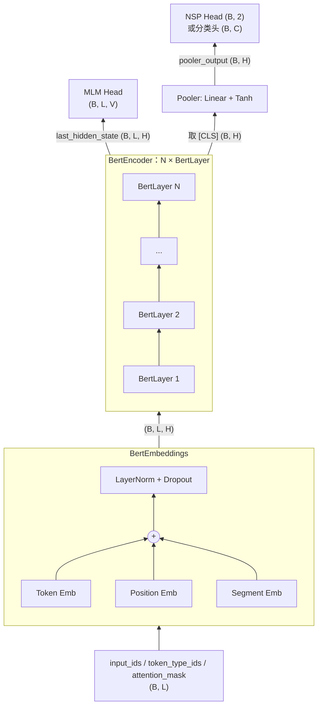
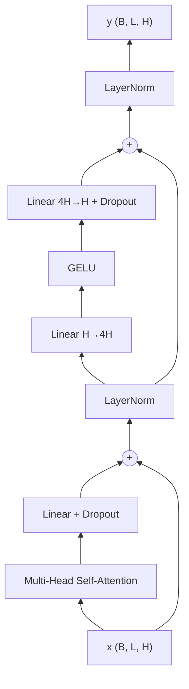

# 03 · 完整架构

BERT = **Embedding 层** + **N 层 Transformer Encoder** + **任务头**。

## 1. 总览

## 2. 模型规模

| 配置 | 层数 N | 隐藏维度 H | 头数 A | FFN 维度 | 参数量 |
| --- | --- | --- | --- | --- | --- |
| BERT-Base | 12 | 768 | 12 | 3072 | 110M |
| BERT-Large | 24 | 1024 | 16 | 4096 | 340M |
| tiny（本仓库调试用） | 2 | 128 | 2 | 512 | ~0.5M（随词表变化） |

FFN 维度固定为 $4H$，每个头的维度 $d_k = H / A = 64$。

## 3. 一个 Encoder 层（BertLayer）

BERT 使用 **Post-LN**（先残差相加，再 LayerNorm），与原始 Transformer 一致。

公式：

$$
\begin{aligned}
h &= \text{LayerNorm}\big(x + \text{Dropout}(\text{MHA}(x)\,W^O)\big) \\
y &= \text{LayerNorm}\big(h + \text{Dropout}(\text{GELU}(h W_1 + b_1) W_2 + b_2)\big)
\end{aligned}
$$

### 3.1 多头自注意力

$$
Q = xW^Q,\; K = xW^K,\; V = xW^V \quad\in \mathbb{R}^{B\times L\times H}
$$

拆成 $A$ 个头：$(B, L, H) \to (B, A, L, d_k)$，对每个头：

$$
\text{Attention}(Q, K, V) = \text{softmax}\left(\frac{QK^\top}{\sqrt{d_k}} + M\right)V
$$

- 除以 $\sqrt{d_k}$：防止点积过大导致 softmax 饱和、梯度消失。
- $M$：padding 加性掩码（见 [02_input.md](02_input.md)），**没有**因果掩码。
- 注意力矩阵形状 $(B, A, L, L)$，计算量 $O(L^2)$。

最后把各头拼回 $(B, L, H)$，再经过输出投影 $W^O$。

### 3.2 GELU

$$
\text{GELU}(x) = x\,\Phi(x) = \frac{x}{2}\left(1 + \text{erf}\left(\frac{x}{\sqrt 2}\right)\right)
$$

比 ReLU 更平滑，BERT 之后几乎成为 Transformer 的默认激活函数。

## 4. 逐层张量形状（BERT-Base，B=批大小，L=序列长度）

| 位置 | 形状 |
| --- | --- |
| `input_ids` | `(B, L)` |
| Embedding 输出 | `(B, L, 768)` |
| Q / K / V（拆头后） | `(B, 12, L, 64)` |
| 注意力分数 / 概率 | `(B, 12, L, L)` |
| FFN 中间层 | `(B, L, 3072)` |
| 每层输出 / `last_hidden_state` | `(B, L, 768)` |
| `pooler_output` | `(B, 768)` |
| MLM logits | `(B, L, 30522)` |
| NSP logits | `(B, 2)` |

## 5. 输出与任务头

- **Pooler**：取 `[CLS]` 位置的隐状态 $h_0$，`tanh(W h_0 + b)`。在预训练中由 NSP 训练，用于句子级任务。
- **MLM Head**：`Linear(H,H) → GELU → LayerNorm → Linear(H,V) + bias`。最后的 `Linear(H,V)` **与 Token Embedding 共享权重**（weight tying），减少参数，并让输入和输出共用同一个词向量空间。
- **NSP Head**：`Linear(H, 2)`，作用于 pooler 输出。
- **分类头**：`Dropout → Linear(H, num_labels)`。

## 6. 参数量估算（BERT-Base）

| 部分 | 计算 | 参数量 |
| --- | --- | --- |
| Token Embedding | 30522 × 768 | 23.4M |
| Position + Segment | (512 + 2) × 768 | 0.4M |
| 每层 Attention | 4 × (768² + 768) | 2.36M |
| 每层 FFN | 2 × 768 × 3072 + 3072 + 768 | 4.72M |
| 每层 LayerNorm × 2 | 4 × 768 | 0.003M |
| 12 层合计 | 12 × 7.08M | 85.0M |
| Pooler | 768² + 768 | 0.6M |
| **合计** | | **≈ 110M** |

## 7. 权重初始化

- Linear / Embedding：$\mathcal{N}(0, 0.02^2)$，bias 置 0。
- LayerNorm：$\gamma = 1, \beta = 0$。
- `[PAD]` 的 embedding 置 0。

## 代码对应

| 组件 | 文件 |
| --- | --- |
| 配置 | [config.py](../config.py) |
| 多头注意力 / BertAttention | [modules/attention.py](../modules/attention.py) |
| FFN | [modules/feed_forward.py](../modules/feed_forward.py) |
| BertLayer / BertEncoder | [modules/layer.py](../modules/layer.py)、[modules/encoder.py](../modules/encoder.py) |
| Pooler | [modules/pooler.py](../modules/pooler.py) |
| 主干、初始化 | [model.py](../model.py) |
| 任务头、权重共享 | [heads.py](../heads.py) |
